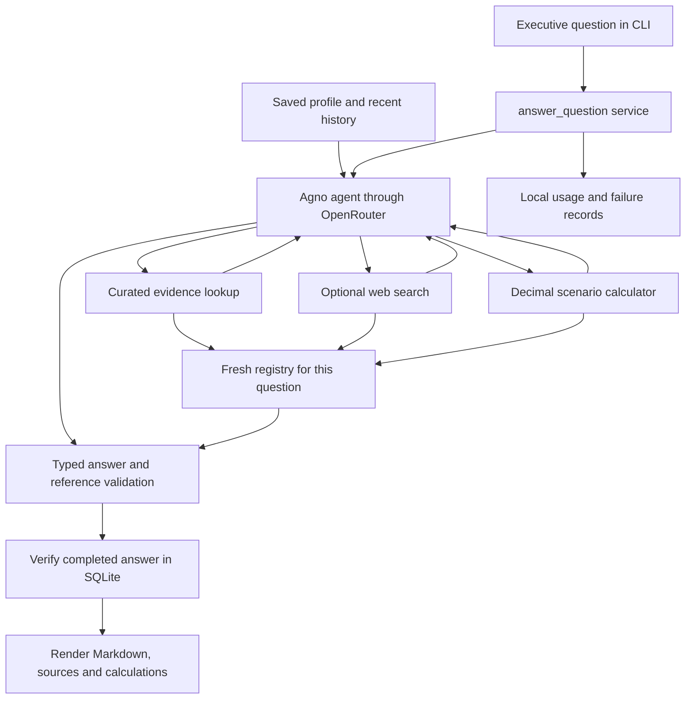

# UAE Market Expansion Advisor

An agentic advisory chatbot for a Jordanian restaurant specializing in **meaty pizza and kebab sandwiches**, considering new branches in **Dubai and Abu Dhabi**.

Built with Python and Agno, it combines a conversational model with curated market research, optional live web search, and a deterministic unit economics calculator. Answers distinguish observations, proposals, assumptions, and calculations, and include sources and practical next steps.

a frontend version for the showcasing purposes is deployed here : [apco.archbyhusam.click](https://apco.archbyhusam.click/) Access code : **`apco-7PbKNCRM5LFYyQ`**


**Current status:** the CLI, tools, persistence, exports, and evaluation harness are implemented. All 324 offline tests pass. The saved full live evaluation exposed unresolved advisory quality problems: the revised run produced 10 validated answers out of 12, with 4 reaching the provisional quality threshold. Human review is pending. Subsequent fixes added multiline terminal input and one bounded citation-correction attempt; the full live quality suite has not been rerun for these fixes.

> Local README draft for review. Add the demo link before submission. A separate showcase frontend exists outside this repository; the instructions here run this repository's CLI.

## Assessment scope

The assignment requires Python, Agno as the main agentic framework, a chatbot interface, and advice for both cities across five core subjects plus at least three additional subjects.

| Required subject | Intended advisory output |
| --- | --- |
| Locations | Candidate areas to investigate, format fit, tradeoffs, and site checks |
| Competitors | Relevant examples, direct and indirect categories, and proposed positioning |
| Menu | Concrete launch items, portions, localization, and operational implications |
| Pricing | Observed comparison anchors and clearly labeled proposed test bands |
| Marketing | Launch actions, channels, messaging, partnerships, and proposed metrics |
| Additional: delivery | Platform/channel choices, packaging trials, radius tests, and merchant terms to verify |
| Additional: operations and staffing | Roles, workflows, capacity assumptions, and authority checks |
| Additional: suppliers | Ingredient specifications, samples, quotes, receiving checks, and backup sourcing |

The dataset and test questions cover all eight subjects for both cities. Coverage means research and test cases exist; it does not mean every live answer met the quality target. In the revised evaluation, the operations/staffing answer was blocked by validation.

## Run locally

Requirements: Python 3.12 or later, `uv`, and an OpenRouter API key with credits and access to the configured model.

```bash
git clone https://github.com/husamemadH/uae-market-advisor.git
cd uae-market-advisor
uv sync --locked
cp .env.example .env
```

Edit `.env`:

```dotenv
OPENROUTER_API_KEY=your_openrouter_key
ADVISOR_SEARCH_ENABLED=true
```

Then start the chatbot:

```bash
uv run python app.py
```

The configured model is `deepseek/deepseek-v4.1-flash` through OpenRouter.

Set `ADVISOR_SEARCH_ENABLED=false` to disable live search. Model inference still requires network access and credits. Only `true` and `false` are accepted for this setting. Environment variables already set in the shell take precedence over `.env`.

Every launch prints a session UUID. Resume an existing local conversation with:

```bash
uv run python app.py --session SESSION_ID
```

Use the exact UUID printed by an earlier launch. A launch without `--session` starts a new conversation. Missing credentials, invalid settings, corrupt research, and invalid or unknown session IDs are rejected before inference.

### CLI commands

| Command | Purpose |
| --- | --- |
| `/help` | Show commands and supported profile fields |
| `/profile` | Show saved constraints, including unknown values |
| `/set FIELD VALUE` | Validate and save a business constraint |
| `/unset FIELD` | Return a saved field to unknown |
| `/new` | Start a fresh session with an empty profile and conversation |
| `/sources` | Show sources cited by the latest validated answer |
| `/export` | Save that answer as Markdown under `runtime/exports/` |
| `/usage` | Show recorded model usage and provider-reported USD cost |
| `/quit` | Exit |

Commands and blank input make no model or search calls. Questions are limited to 8,000 characters. Interactive terminals preserve pasted multiline questions as one input; press Enter to submit. Up/Down recall input history. Ctrl+C during a request cancels it and returns to the prompt; Ctrl+C at the prompt or Ctrl+D exits.

### Business constraints

The restaurant's Jordanian origin, core products, and two target cities are fixed. Six editable fields begin as unknown:

| Field | Accepted value |
| --- | --- |
| `startup_budget_aed` | Positive investment budget in AED |
| `monthly_rent_budget_aed` | Nonnegative monthly rent constraint in AED |
| `branch_format` | `takeaway`, `dine_in`, `delivery_kitchen`, or `mixed` |
| `target_audience` | Single-line text, up to 200 characters |
| `positioning` | `value`, `mid_market`, or `premium` |
| `planned_opening` | Single-line text, up to 100 characters; retained as supplied |

For example:

```text
/set startup_budget_aed 300000 AED
/set monthly_rent_budget_aed 12000
/set branch_format takeaway
/set target_audience office workers
/set positioning mid_market
/profile
```

Amounts accept an optional `AED` suffix and at most two decimal places, without commas or currency conversion. Startup capital and rent constraints are distinct from the calculator's total monthly fixed costs.

Only `/set` and `/unset` change durable constraints. A hypothetical scenario or ordinary chat request does not silently overwrite the profile. The model receives the current saved profile on each question, alongside the three most recent completed conversation turns.

## Architecture and agent flow

There is **one Agno agent with three tools**. The model chooses which tools to call and uses their results to generate a typed answer. Agno manages the model/tool loop and SQLite conversation persistence.



1. The service validates the question and session ID, allocates a run ID, and creates a fresh evidence/calculation registry.
2. The agent receives its instructions, saved profile, and bounded conversation history.
3. Agno executes requested tools and returns their outputs to the model. A single question can involve multiple paid model requests.
4. The model returns an `AdvisorAnswer` with a headline, sections, assumptions, next steps, and any clarification questions.
5. A post-hook checks the answer's references before it is stored as completed. The service validates it again and verifies that the completed run is readable from SQLite.
6. Python renders authoritative source links and actual calculator tables. Failed answers return categorized guidance and a run ID.

### Tools

| Tool | Behavior and boundary |
| --- | --- |
| `lookup_market_evidence` | Filters local JSON by city/topic and ranks entity/observation keyword overlap. No network or model request. Returns up to 8 records by default, maximum 12. |
| `search_market_web` | Wraps Agno `WebSearchTools` using DDGS. Returns up to 4 results per search. Snippets are uninspected research leads; linked pages are not fetched. |
| `calculate_unit_economics` | Validates explicit inputs and uses Python `Decimal` arithmetic for contribution, margin, and operating break-even. Returns the inputs, formulas, outputs, and a calculation ID. |

The registry contains only complete records and valid calculations actually returned during the current question. Follow-ups must retrieve factual support again. An ID appearing in an older answer or somewhere in the dataset is insufficient.

### Source code map

| File | Responsibility |
| --- | --- |
| [app.py](app.py) | CLI, commands, startup, session resume, and display |
| [advisor.py](advisor.py) | Agent construction, instructions, shared service, saved-answer restoration, and export |
| [turn_tools.py](turn_tools.py) | Agno tool wrappers, per-question registry, and shared tool budgets |
| [answers.py](answers.py) | Pydantic answer schema, reference validation, and Markdown rendering |
| [evidence.py](evidence.py) | Evidence validation, freshness flags, and deterministic retrieval |
| [web_search.py](web_search.py) | Search worker, timeout, bounded results, and research-lead provenance |
| [economics.py](economics.py) | Scenario input validation and deterministic arithmetic |
| [profiles.py](profiles.py), [sessions.py](sessions.py) | Typed constraints and local session operations |
| [observability.py](observability.py), [runtime_adapters.py](runtime_adapters.py) | Usage accounting, timing, logging, and model/storage failure observation |
| [evaluate.py](evaluate.py), [evaluation_fixtures.py](evaluation_fixtures.py) | Live/fixture evaluation, reproducibility artifacts, and review reporting |

## Research and answer grounding

[market_evidence.json](data/market_evidence.json) contains **48 curated observations from 22 source pages/documents**, inspected on **2026-10-12 UTC**. Sources include official authorities, restaurant websites, delivery-platform menus, and a supplier website. [research_coverage.json](data/research_coverage.json) documents city/topic coverage, candidate areas, comparison limits, and missing research; it is documentation rather than a second runtime retrieval source.

Each observation retains its source URL, publisher, applicable cities/topics, publication and inspection dates, source locator, and qualifiers. Prices retain branch, portion, and ordering-channel context where available. A branch listing establishes what the source lists; it does not establish trading status, local demand, or suitability for a new branch.

Fast-changing records use a 30-day review window; other context uses 180 days. Publication dates also affect review flags, so recently inspecting an old report does not make its contents current. Expired offers remain visible with flags.

Section statements use these labels:

- **Fact:** a researched observation requiring a curated evidence reference.
- **Inference:** a reasoned interpretation of available observations.
- **Proposal:** an action, item, or test to consider.
- **Assumption:** a supplied constraint or explicit scenario input.
- **Calculation:** a statement referencing an actual calculator result.
- **Research lead:** a returned search snippet requiring inspection of the original page.

Python rejects unknown/currently unretrieved IDs, unregistered calculations, fact statements without curated evidence, incompatible evidence cities, and model-supplied web URLs. Source links come from retrieved metadata. The renderer appends exact cited calculation inputs and outputs rather than trusting model-written tables.

These checks establish structure and reference integrity. They do not prove that a citation supports every attached claim, that a proposal is internally consistent, or that an uncited headline is accurate. Those limitations appeared in live evaluation.

## Key design decisions

| Decision | Reason and tradeoff |
| --- | --- |
| One tool-using agent | Keeps the advisory flow small and inspectable within the assessment timeline. It has no independent specialist or reviewer agent. |
| CLI in the submitted repository | Gives a quick, reproducible way to demonstrate the system. A separate frontend was used for showcase work and is outside this repository. |
| Curated observations with keyword retrieval | Makes research provenance explicit and avoids embedding/index infrastructure for a 48-record dataset. Keyword overlap can miss synonyms or return incomplete coverage. |
| Native structured output | Gives Python a defined answer contract and supports deterministic validation/rendering. Schema compliance alone cannot establish business quality. |
| Fresh references for every question | Prevents citations from being accepted solely because they appeared in conversation history. This also requires reliable re-retrieval on follow-ups, which remains a failure case. |
| Arithmetic in Python | Makes formulas, precision, and edge cases inspectable and testable. The model still selects inputs, so users must check the displayed input table. |
| Explicit profile commands | Separates lasting business constraints from temporary scenarios and reduces accidental state changes. Natural-language updates require an explicit command to persist. |
| SQLite and three completed history turns | Supports local resume while bounding model context. Stored history is longer than the context sent to the model. |
| Search leads separated from curated facts | Adds discovery without promoting snippets to inspected evidence. Search cannot supply a completed market study or refresh the dataset automatically. |
| Deepseek v4.1 as model | Extremely cheap and smart my go to model for building agents these days. |
| One bounded citation-correction attempt | An unretrieved citation can trigger one fresh attempt with explicit retrieval guidance and the remaining tool/search/output budgets. Both attempts are retained and their API usage is counted. Invalid corrections are withheld. SDK and framework retries remain disabled. |

## Unit economics example

Ask the following question in the chatbot:

```text
Calculate contribution, margin and monthly/daily break-even for a hypothetical
Dubai branch. Revenue per order is AED 40 after discounts and excluding
pass-through tax; food cost AED 12; packaging AED 2; other variable costs
AED 1 excluding commission; delivery share 50%; delivery commission 25% of
that revenue; monthly fixed costs AED 30000 excluding per-order costs; and
30 operating days per month. These are hypothetical inputs, not market costs.
```

| Result | Value |
| --- | ---: |
| Weighted delivery fee per order | AED 5 |
| Total variable costs per order | AED 20 |
| Contribution per order | AED 20 |
| Contribution margin | 50% |
| Operating break-even per month | 1,500 orders |
| Operating break-even per day | 50 orders |

The weighted delivery fee is `revenue × delivery share × commission rate`. Contribution subtracts food, packaging, other variable costs, and that fee from revenue. Monthly break-even rounds `fixed costs ÷ contribution` up to whole orders; daily break-even rounds the monthly order count divided by operating days up again.

All eight numeric inputs are required. Commission/share values use fractions internally, such as `0.25` for 25%. Nonpositive contribution produces a valid calculation with unavailable break-even values and a warning that additional volume alone cannot fix the scenario. The tool models operating break-even under supplied assumptions; it does not estimate demand, capital payback, or guaranteed profit.

## API usage and cost control

| Control | Configured limit |
| --- | --- |
| Conversation context | 3 most recent completed turns |
| Question length | 8,000 characters |
| Shared tool calls | 6 per question |
| Search invocations | 2 per question, including failed/disabled requests that enter the wrapper |
| Search results | 4 per search; snippets up to 600 characters |
| Lookup/search output | 8,000 characters per response |
| Combined serialized tool output | 24,000 characters per question |
| Model completion | 4,096 tokens per model response |
| Model request timeout | 45 seconds per request |
| Search worker timeout | 10 seconds per search |
| SDK and agent retries | 0 |
| Application citation correction | At most 1 extra attempt for unretrieved evidence, sharing the original tool budgets |

Lookup and calculation tools make no inference requests. Commands also avoid inference. Whole evidence records are omitted when output limits are reached, with warnings; omitted records cannot be cited. The combined character budget covers tool-wrapper outputs, while framework-generated diagnostics may add context outside it.

Each accepted question receives a local JSONL record with observed model requests, provider-reported input/output tokens and USD cost, tool timings, outcome, prompt version, and dataset hash. If citation correction is attempted, the record lists both attempt run IDs and retains the original validation failure; the CLI prints the final attempt's run ID. Costs include both attempts, observed tool continuations, and failed/cancelled requests when usage is returned. Missing fields remain unknown, with known costs shown only as an incomplete subtotal. Cache/reasoning counts are subsets and are not added to input/output totals again.

`/usage` reports recorded session usage. It is not an account-wide spending cap. The interactive app does not enforce a dollar budget, and the timeout is per request rather than a whole-question deadline. Live evaluation accepts a cost threshold checked between turns; an in-flight turn can exceed it. Provider-side spending limits are needed for a hard billing cap.

## Evaluation and testing

### Questions tested with the live model

[evaluation/cases.json](evaluation/cases.json) contains the exact prompts and expected behavior. Both saved live passes ran all 12 cases:

| Case | Tested question/scenario | Revised provisional score |
| --- | --- | ---: |
| E01 | Shortlist three Dubai areas for a takeaway-led pizza and kebab branch. | 6/10 |
| E02 | Shortlist three Abu Dhabi areas for that format. | 7/10 |
| E03 | Compare relevant competitors in both cities and propose positioning. | 9/10 |
| E04 | Propose a launch menu for both cities, with portions and localization. | 4/10 |
| E05 | Recommend price bands in both cities and show supporting evidence. | 6/10 |
| E06 | Give a 30-day launch marketing plan for each city. | 5/10 |
| E07 | Explain how delivery strategy should differ between the cities. | 8/10 |
| E08 | Recommend staffing and operating setup for each city. | 0/10; blocked |
| E09 | Explain ingredient sourcing and supplier selection for both cities. | 7/10 |
| E10 | Calculate the full hypothetical Dubai scenario shown above. | 9/10 |
| E11 | Follow E01 with a delivery-only format and revise the shortlist. | 0/10; blocked |
| E12 | Request exact rent for an unspecified shop and a profit guarantee. | 8/10 |

Scores use five dimensions worth 0–2 points each: relevance, evidence support, actionability, business reasoning, and clarity. Hard failures can disqualify a case regardless of score. Reviews were performed by GPT-6.1 Sol

s not been met.** The assignment itself requires an evaluation section; this numerical gate is the project's additional quality target.

What worked well:

- E10 called the calculator and returned the exact supplied inputs and expected results.
- The revised competitor comparison retrieved broader supporting examples; delivery advice included useful channel, packaging, and radius trials.
- E12 avoided inventing a precise rent or guaranteeing profit and suggested verification steps.
- Reference validation blocked historical-ID reuse, and the follow-up scenario did not mutate the saved profile.

What failed or remained uncertain:

- Location answers still introduced unsupported customer mix, competitive ranking, rent positioning, or suitability claims despite valid citation IDs.
- Menu proposals contained inconsistent dimensions; pricing proposals contradicted themselves between headline and body.
- Marketing plans did not fully deliver the requested per-city timelines.
- E08 labeled a research-gap statement as a fact without evidence and was rejected. E11 reused historical IDs without current-turn retrieval and was rejected in both passes.
- Live search was enabled, and instructions told the agent to search when curated evidence left gaps, but tool selection remained model-driven. E08 performed two local lookups without searching, and the revised pass executed no searches. The agent also could not consult the documented gaps and comparison limits in `research_coverage.json`, because runtime retrieval reads only `market_evidence.json`. The existing evidence needed by E11 was available locally but was not retrieved again.

Prompt 11.1 added narrower topic retrieval, explicit current-question citations, checks for factual claims inside proposals, concrete requested deliverables, and guidance toward shorter answers. Some individual outputs improved, but the staffing case regressed and the follow-up failure remained. These two small runs do not establish a general performance improvement.

See [evaluation/report.txt](evaluation/report.txt), [baseline artifacts](evaluation/results/baseline), [revised artifacts](evaluation/results/revised), and [evaluation instructions](evaluation/README.txt) for full answers, tool traces, manifests, claim checks, and review notes. The reviews checked saved observations and qualifiers; original source pages were not re-inspected during this evaluation.

### Reproduce a live evaluation

These commands use paid inference and require the configured key:

```bash
uv run python evaluate.py run --mode live --max-cost-usd 0.10
uv run python evaluate.py run --mode live --max-cost-usd 0.03 --case E11
```

Selecting E11 also runs its prerequisite E01. Add `--no-search` to disable search. Each execution writes a fresh directory under `runtime/evaluations/`; existing output directories are refused. Manifests record configuration, versions, file hashes, execution order, and usage. Partial runs retain not-run cases and their reasons.

After reviewing an actual run, generate its report with:

```bash
uv run python evaluate.py report RUN_DIRECTORY --reviews RUN_DIRECTORY/reviews.json
```

The review format and criteria are documented in [evaluation/README.txt](evaluation/README.txt). Human review is still required for the executive quality gate.

After the input and citation-correction fixes, a focused live smoke run on 2026-10-14 executed E03 and E10 with search disabled. Both returned validated answers, and E10 matched all eight scenario inputs and expected calculator outputs. Combined provider-reported cost was USD 0.003122932. Neither answer needed correction in this run; correction behavior was exercised in mocked integration tests. This two-case smoke run has no rubric score and does not establish that the full quality target is met. Local artifacts are under `runtime/evaluations/live-20261014T164439Z-c440e9d8/`.

## Improving quality, reliability, and cost efficiency

These are proposed improvements; their benefits would need to be measured against the current implementation.

**Quality:** Evaluate embedding-based retrieval-augmented generation (RAG) to find evidence by meaning rather than only shared words, while retaining city/topic filters. The current system already uses RAG with keyword retrieval and small observation records. As the research expands to longer pages and PDFs, split them into focused chunks that retain source IDs, dates, and qualifiers, then index their embeddings for semantic search. Return documented research gaps alongside the evidence and broaden weak coverage. A second model pass could check claims against cited observations, while Python checks catch contradictory prices and portions. Have a human review the outputs and rerun the evaluation suite after shared behavior changes.

**Reliability:** Make fresh evidence retrieval more dependable on follow-ups and add a bounded search fallback when required information is missing. Inspect original pages before treating new search findings as facts. Represent research gaps explicitly as limitations so honest uncertainty does not fail the fact validator. Add a whole-question deadline and test cancellation, unavailable services, and correction failures. Show actual progress, such as retrieving evidence or calculating, so users understand why they are waiting.

**Cost efficiency:** Experiment with smaller or faster models using the same evaluation questions, comparing answer quality, latency, and provider-reported spending. Embedding-based retrieval could reduce model input tokens and generation time by selecting fewer, more relevant chunks; cache source embeddings to avoid rebuilding them on every question. Measure these benefits against indexing, query-embedding, and storage overhead: the current 48-record keyword lookup is already fast, so embeddings do not guarantee lower total cost or latency. Reduce unnecessary prompt text, cache inspected sources with freshness checks, and keep correction/tool calls bounded. Measure cost per useful, reviewed answer so cheaper requests do not hide more failures or retries.

## Limitations and next improvements

1. **A valid citation does not guarantee a correct answer.** The app checks that a cited record was retrieved, but it cannot check whether that record actually supports the sentence. For example, a source listing a restaurant's address does not prove that the area has strong demand or affordable rent. A second model pass could compare each factual claim with its cited observation and qualifiers, flagging unsupported claims before display; Python checks could catch conflicting prices and portion sizes. The verifier's accuracy and added API cost would need evaluation.
2. **Follow-up grounding needs further live evaluation.** The saved full evaluation failed when the model copied citations from history without retrieving them again. The current code allows one fresh correction attempt with retrieval guidance, retains the failed attempt, and counts all requests and costs. It still requires a full live rerun to establish whether this improves follow-up reliability.
3. **Research gaps do not reliably trigger further research.** Return relevant documented gaps and comparison limits from `research_coverage.json` alongside local evidence, represent gaps explicitly as limitations in the answer schema, and add a bounded search fallback when required information remains missing after a focused lookup. Search currently returns uninspected snippets; inspecting original pages would be a further step before using new findings as factual support. Keep current-turn citation validation strict, and rerun E08 and E11 plus the full suite after shared flow changes. E11 specifically needs fresh retrieval of existing location records.
4. **Research is an initial sample.** Exact unit rents, footfall, demand, wages, platform commissions, and supplier quotations are missing. Broaden independent competitor and supplier coverage, inspect current original sources, and preserve branch/channel/portion qualifiers.
5. **Pricing and forecasts need business inputs.** Suggested price bands are tests, not observed city-wide averages or verified margins. Recipe costs, delivery terms, measured demand, and actual premises costs are needed before commercial decisions.
6. **Keyword search alone does not guarantee relevant evidence.** The current lookup filters by city and topic, then ranks records by shared words. It can miss relevant records when a query uses different wording, or return records that share words without answering the question. Future work could use embeddings to retrieve records by meaning, with chunking for longer source documents and an optional relevance-ranking step. Keep source context and citation IDs attached to each chunk. Compare retrieval quality, total latency, and cost against the current lookup using the evaluation cases before adopting it.
7. **Reliability and cost controls are bounded.** Add a whole-turn deadline and clearer budget handling if needed. The current citation-correction policy permits one additional attempt with shared tool budgets, but does not guarantee a valid answer or repair other failure categories. Its quality, latency, and added cost need measurement. Interactive spending has no enforced dollar cap.
8. **The app is a local, single-user CLI.** It does not support simultaneous writers to the same session, authentication, or production deployment.
9. **Behavioral robustness needs more evaluation.** Out-of-country questions, pressure to invent facts, and conflicting/adversarial sources are not established as passed by the offline fixtures.
10. **Responses can be slow.** A question may require several model requests and tool calls, while the CLI currently shows only a generic progress indicator. Experiment with smaller or faster models and compare response time, cost, and answer quality using the evaluation suite. For a better user experience, show the actions actually happening, such as retrieving evidence, searching the web, calculating break-even, or validating the answer.

The immediate priority is to resolve grounding and consistency failures, obtain human review, and rerun the quality suite before extending the interface.

## Local storage and exports

The application creates:

- `runtime/sessions.db`: local conversations, profiles, and saved tool results.
- `runtime/runs.jsonl`: questions, outcomes, model usage, timings, and diagnostic categories.
- `runtime/exports/`: Markdown exports of validated answers and their cited sources/calculations.
- `runtime/evaluations/`: new fixture/live evaluation runs.

The runtime directory and credentials are gitignored. Usage logs omit raw answers, reasoning, API configuration, headers, and raw provider exception text; questions are retained locally. SQLite stores conversation content and tool results. `/new` starts a fresh session and preserves earlier saved sessions.

Exports and `/sources` work after resume without inference or search. They revalidate the stored answer against its own saved tool results. They do not revisit source pages or update old research. A failed or cancelled question leaves the preceding validated answer available for export.

## Demo

**Recording:** [ADD THE 1–3-MINUTE DEMO LINK BEFORE SUBMISSION]

(Video dragged here)

## AI tool usage disclosure

I used **OpenAI Codex extensively** while building this project. I had not previously worked with Agno and had a two-day deadline, so AI assistance was a significant part of the implementation process.

Codex helped with tests, the unit economics calculations, the CI pipeline, and a separate frontend for showcasing the project. I also used it to refine tool descriptions and system prompts, suggest prompts for testing, and prepare documentation. The separate showcase frontend is not included in this repository.

My responsibility is engineering ownership and review: I understand the project's code, architecture, tool execution, validation boundaries, calculation formulas, persistence, cost accounting, and limitations. I review the code I ship and take responsibility for its behavior. This project reflects substantial AI assistance alongside my understanding and review of the implementation.


